# 03 — Skill e workflow per gli agenti di coding

Stato: `in revisione` · Verifica fonti: 31/10/2026 (manifest `.claude-plugin/marketplace.json` letti direttamente dai repository GitHub)

L'obiettivo è usare **tante skill, ma ognuna al momento giusto**. Le skill sono istruzioni che l'agente esegue con i
tuoi permessi. Quindi:

> 🔒 **Regola 1 — Prima si legge, poi si installa.** Una skill di terze parti è codice (Markdown + eventuali script)
> eseguito con i privilegi dell'agente: prima di abilitarla si legge il `SKILL.md` e gli script, poi si fissa la versione
> (tag o commit). Vale soprattutto per le skill della community (Three.js).
>
> **Regola 2 — Una skill principale per fase.** I pacchetti di Addy Osmani e di Matt Pocock si sovrappongono (TDD,
> code review, interviste). Se sono attivi entrambi, **si nomina nel prompt la skill da usare** ("usa la skill `tdd`").
> La [matrice](#matrice-fase--skill) qui sotto indica la scelta predefinita.

---

## 1. Pacchetti consigliati

| Pacchetto | Autore | Licenza | Perché ci serve |
|-----------|--------|---------|-----------------|
| [`addyosmani/agent-skills`](https://github.com/addyosmani/agent-skills) | Addy Osmani | MIT | Ciclo completo spec → plan → build → verify → review → ship, sicurezza, performance web, ADR |
| [`mattpocock/skills`](https://github.com/mattpocock/skills) | Matt Pocock | MIT | Interviste ("grilling") che **trovano ciò che manca**, glossario/ADR, ticket con dipendenze, TDD a slice verticali |
| [`greensock/gsap-skills`](https://github.com/greensock/gsap-skills) | GreenSock (ufficiale) | MIT (GSAP è gratuito, plugin inclusi) | Animazioni, ScrollTrigger, SplitText, Flip, `useGSAP`, performance |
| [`emalorenzo/three-agent-skills`](https://github.com/emalorenzo/three-agent-skills) | community | MIT | Three.js e React Three Fiber: memoria, render loop, shader, asset ⚠️ community, va revisionata |
| [`expo/skills`](https://github.com/expo/skills) | Expo (ufficiale) | MIT (skill EAS = servizi a pagamento) | App iOS/Android, Expo Router, UI nativa, build e pubblicazione sugli store |
| [`supabase/agent-skills`](https://github.com/supabase/agent-skills) → `postgres-best-practices` | Supabase (ufficiale) | — | Regole PostgreSQL (indici, query, schema) valide per **qualsiasi** Postgres, non solo Supabase |
| [`trailofbits/skills`](https://github.com/trailofbits/skills) | Trail of Bits | — | Sicurezza seria: Semgrep/CodeQL, default insicuri, review differenziale, supply chain, property-based testing |
| [`anthropics/skills`](https://github.com/anthropics/skills) | Anthropic | Apache-2.0 | `frontend-design` (niente estetica "generata dall'AI"), `mcp-builder`, `webapp-testing` (Playwright) |
| [`vercel-labs/agent-skills`](https://github.com/vercel-labs/agent-skills) | Vercel | — | `react-best-practices`, `web-design-guidelines` (audit a11y/UX con riferimenti file:riga) |

Skill **già disponibili** in Claude Code, senza installazione: `/security-review`, `/code-review`, `/simplify`, `claude-api`.

## 2. Installazione (Claude Code)

I marketplace sono già dichiarati in [`.claude/settings.json`](../.claude/settings.json) (`extraKnownMarketplaces`).
I plugin **non** sono abilitati automaticamente (Regola 1): li abiliti tu dopo la revisione.

```text
# Engineering (Addy Osmani)
/plugin install agent-skills@addy-agent-skills

# Engineering + produttività (Matt Pocock)
/plugin install mattpocock-skills@mattpocock
# poi, una volta per repo:
/setup-matt-pocock-skills      → issue tracker: GitHub · documenti: docs/ · etichette: vedi §5

# GSAP (ufficiale)
/plugin install gsap-skills@gsap-skills

# Expo (ufficiale)
/plugin install expo@expo-plugins

# PostgreSQL
/plugin install postgres-best-practices@supabase-agent-skills

# Sicurezza (Trail of Bits): installare SOLO questi
/plugin install static-analysis@trailofbits
/plugin install semgrep-rule-creator@trailofbits
/plugin install insecure-defaults@trailofbits
/plugin install sharp-edges@trailofbits
/plugin install differential-review@trailofbits
/plugin install supply-chain-risk-auditor@trailofbits
/plugin install property-based-testing@trailofbits
/plugin install audit-context-building@trailofbits
/plugin install agentic-actions-auditor@trailofbits
/plugin install testing-handbook-skills@trailofbits

# Anthropic (contiene anche skill non pertinenti: usare solo quelle in tabella §3)
/plugin install example-skills@anthropic-agent-skills
```

Skill senza marketplace Claude: si installano con la CLI `skills`, che le copia in `.claude/skills/` e le rende versionabili.

```bash
npx skills@latest add emalorenzo/three-agent-skills --skill r3f-best-practices -a claude-code
```

```bash
npx skills@latest add emalorenzo/three-agent-skills --skill three-best-practices -a claude-code
```

```bash
npx skills@latest add vercel-labs/agent-skills --skill react-best-practices -a claude-code
```

```bash
npx skills@latest add vercel-labs/agent-skills --skill web-design-guidelines -a claude-code
```

> Dopo `npx skills add` si fa il commit della cartella `.claude/skills/<nome>`: così la versione è fissata e revisionata in PR.

## 3. Catalogo: quali skill usiamo, e per cosa

### Definire (capire cosa costruire)

| Skill | Pacchetto | Uso nel progetto |
|-------|-----------|------------------|
| `grill-with-docs` | Matt | **Primo passo assoluto:** interroga il brief ([01](01-brief-cliente.md)) finché ogni ramo è risolto, aggiornando glossario e ADR |
| `grill-me` | Matt | Interrogare una singola decisione (es. "serve la caparra?") |
| `to-questionnaire` | Matt | Trasforma [17 Domande aperte](17-domande-aperte.md) in un **questionario da mandare ad Arturo** |
| `domain-modeling` | Matt | Rifinisce i termini del [glossario](glossario.md) con i casi limite (tempo di posa, pool, hold…) |
| `idea-refine` | Addy | Concept creativi per l'hero 3D e lo storytelling del sito |
| `constraint-driven-development` (`/constraints`) | Addy | Mantiene [CONSTRAINTS.md](../CONSTRAINTS.md) e intercetta gli agenti che spengono check o saltano test |

### Specificare e pianificare

| Skill | Pacchetto | Uso |
|-------|-----------|-----|
| `spec-driven-development` (`/spec`) | Addy | Una spec per modulo in `docs/specs/` (motore slot, pannello, app, MCP) |
| `planning-and-task-breakdown` (`/plan`) | Addy | Divide la spec in task piccoli, verificabili, con dipendenze |
| `to-tickets` | Matt | Pubblica i task come **issue GitHub** con dipendenze bloccanti |
| `wayfinder` | Matt | Per decisioni grandi e incerte (es. strategia Malta): mappa di ticket-decisione |
| `prototype` | Matt | Prototipi usa e getta: hero WebGL su telefono di fascia media, spike dell'algoritmo slot |
| `research` | Matt | Ricerca da fonti primarie salvata in `docs/research/` (regole store, spec MCP, GDPR Malta) |

### Costruire

| Area | Skill | Pacchetto |
|------|-------|-----------|
| Metodo | `incremental-implementation`, `tdd` (**predefinita per il TDD**), `implement` | Addy, Matt |
| Architettura | `codebase-design` (moduli profondi, interfacce piccole), `api-and-interface-design` | Matt, Addy |
| Documentazione ufficiale | `source-driven-development`: ogni scelta di framework si basa sulla doc ufficiale, citata | Addy |
| Database | `postgres-best-practices` | Supabase |
| Frontend / design | `frontend-design`, `frontend-ui-engineering`, `react-best-practices` | Anthropic, Addy, Vercel |
| Animazioni | `gsap-core`, `gsap-timeline`, `gsap-scrolltrigger`, `gsap-plugins` (SplitText, Flip, Draggable), `gsap-utils`, `gsap-react`, `gsap-performance` | GSAP |
| 3D | `r3f-best-practices`, `three-best-practices` | community |
| Mobile | `expo-overview`, `expo-project-structure`, `expo-router`, `expo-native-ui`, `expo-design-system`, `expo-animation`, `expo-ui`, `expo-data-fetching`, `expo-dev-client`, `expo-upgrade` | Expo |
| Store | `eas-app-stores`, `eas-update`, `eas-workflows` (⚠️ servizi EAS a pagamento oltre il piano gratuito) | Expo |
| MCP | `mcp-builder` | Anthropic |
| Integrazione LLM | `claude-api` (già presente) | — |

### Verificare

| Skill | Pacchetto | Uso |
|-------|-----------|-----|
| `property-based-testing` | ToB | **Fondamentale** sul motore slot: proprietà come "nessuno slot restituito si sovrappone a un'allocazione attiva" (fast-check) |
| `browser-testing-with-devtools` | Addy | DOM, console, rete e performance dal vivo (Chrome DevTools MCP) |
| `performance-optimization` + `/webperf` + persona `web-performance-auditor` | Addy | Core Web Vitals con GSAP e WebGL attivi |
| `webapp-testing` | Anthropic | E2E con Playwright: flusso di prenotazione, pannello |
| `web-design-guidelines` | Vercel | Audit a11y/UX: focus, form, `prefers-reduced-motion`, i18n |
| `diagnosing-bugs` / `debugging-and-error-recovery` | Matt / Addy | Bug difficili; si chiude sempre con un test di regressione |

### Revisionare e mettere in sicurezza

| Skill | Pacchetto | Uso |
|-------|-----------|-----|
| `/security-review` | integrata | Su ogni PR che tocca auth, API, DB o MCP |
| `security-and-hardening` + persona `security-auditor` | Addy | Threat model, OWASP, header, segreti |
| `insecure-defaults` | ToB | Credenziali di default, fallback di segreti, config permissive (Docker, Caddy, Postgres) |
| `sharp-edges` | ToB | API pericolose: `sql.raw`, `dangerouslySetInnerHTML`, `eval`, deserializzazioni |
| `static-analysis` + `semgrep-rule-creator` | ToB | CodeQL/Semgrep in CI + **regole Semgrep custom** (es. vietato `sql.raw` con input) |
| `differential-review` | ToB | Review di sicurezza del diff, con stima del raggio d'impatto |
| `supply-chain-risk-auditor` | ToB | Audit delle dipendenze npm (dopo gli attacchi supply chain del 2025-2026) |
| `audit-context-building` | ToB | Audit completo pre-lancio, funzione per funzione |
| `agentic-actions-auditor` | ToB | Se usiamo agenti AI dentro GitHub Actions |
| `code-review` / `code-review-and-quality` / `/code-review` | Matt / Addy / integrata | Review rispetto alla spec e ai 5 assi di qualità |
| `doubt-driven-development` | Addy | Review avversaria a contesto fresco sulle decisioni non banali (motore slot, MCP) |
| `code-simplification` / `/simplify` | Addy / integrata | Semplificare senza cambiare il comportamento |

### Rilasciare e mantenere

| Skill | Pacchetto | Uso |
|-------|-----------|-----|
| `ci-cd-and-automation` | Addy | Pipeline e quality gate ([15](15-qualita-test-ci.md)) |
| `git-workflow-and-versioning` | Addy | Trunk-based, commit atomici, Conventional Commits |
| `observability-and-instrumentation` | Addy | Log, metriche RED, tracing, alert ([13](13-infrastruttura-vps.md)) |
| `shipping-and-launch` (`/ship`) | Addy | Checklist pre-lancio, rollout, rollback |
| `documentation-and-adrs` | Addy | ADR in [`docs/adr/`](adr/README.md) |
| `pr` | Matt | Corpo PR e rischio di merge |
| `wizard` | Matt | **Script interattivi per i passi che può fare solo un umano:** account Apple/Google, D-U-N-S, DNS, Meta/Instagram API |
| `handoff` | Matt | Passaggio di contesto tra sessioni o agenti |
| `retro` | Matt | A fine milestone: migliorie all'ambiente di lavoro |
| `writing-for-agents` | Matt | Mantenere [AGENTS.md](../AGENTS.md) e CLAUDE.md leggibili dagli agenti |

## 4. Matrice fase → skill

Skill **predefinita** in grassetto, alternative tra parentesi.

| Fase ([16 Roadmap](16-roadmap.md)) | Definire | Costruire | Verificare | Revisionare |
|------------------------------------|----------|-----------|------------|-------------|
| F0 Fondamenta | **`grill-with-docs`**, `to-questionnaire`, `/constraints` | `ci-cd-and-automation`, `wizard` | — | `insecure-defaults` |
| F1 Motore prenotazioni | **`/spec`**, `domain-modeling` | **`tdd`**, `postgres-best-practices`, `codebase-design` | **`property-based-testing`** | `doubt-driven-development`, `/security-review` |
| F2 Pannello | `/spec` | `tdd`, `frontend-ui-engineering`, `react-best-practices` | `webapp-testing`, `web-design-guidelines` | `/code-review` |
| F3 Sito | `idea-refine`, `prototype` | **`frontend-design`**, `gsap-*`, `r3f-best-practices` | **`/webperf`**, `browser-testing-with-devtools` | `web-design-guidelines` |
| F4 Go-live web | `/plan` | `observability-and-instrumentation` | `testing-handbook-skills` | **`audit-context-building`**, `static-analysis`, `/ship` |
| F5 App | `/spec` | `expo-*` | `webapp-testing` (web), test su dispositivo | `/security-review` |
| F6 MCP | `/spec`, `grill-me` | **`mcp-builder`** | MCP Inspector + test di autorizzazione | `sharp-edges`, `differential-review` |
| F7 Crescita | `wayfinder` | `implement` | — | `retro` |

## 5. Ciclo standard di una funzionalità

```mermaid
flowchart LR
  A["/grill-with-docs<br/>chiarire"] --> B["/spec<br/>docs/specs/*.md"]
  B --> C["/plan"]
  C --> D["to-tickets<br/>issue GitHub"]
  D --> E["tdd<br/>slice verticale"]
  E --> F["verifica<br/>test · webperf · a11y"]
  F --> G["/security-review<br/>differential-review"]
  G --> H["/code-review"]
  H --> I["pr → CI verde → merge"]
  I --> J["/ship"]
  J -.fine milestone.-> K["retro"]
```



**Etichette GitHub** (per `setup-matt-pocock-skills` e `triage`): `area:booking-engine`, `area:admin`, `area:site`,
`area:mobile`, `area:mcp`, `area:infra`, `area:security`, `area:legal`, `type:feature`, `type:bug`, `type:chore`,
`needs:client-input`, `priority:p0`…`p3`, `security`.

## 6. MCP server per lo **sviluppo** (non per la produzione)

| Server | Uso | Limite 🔒 |
|--------|-----|-----------|
| Chrome DevTools MCP | Usato da `browser-testing-with-devtools` e `/webperf` | Solo localhost e staging |
| Playwright MCP | E2E esplorativi | Solo localhost e staging |
| GitHub MCP | Issue, PR, CI | Repo del progetto |
| Postgres MCP **read-only** | Esplorare il DB locale | **Mai** collegato a produzione o staging con dati reali |
| MCP Inspector | Test del **nostro** server MCP ([11](11-mcp-agenti.md)) | — |
