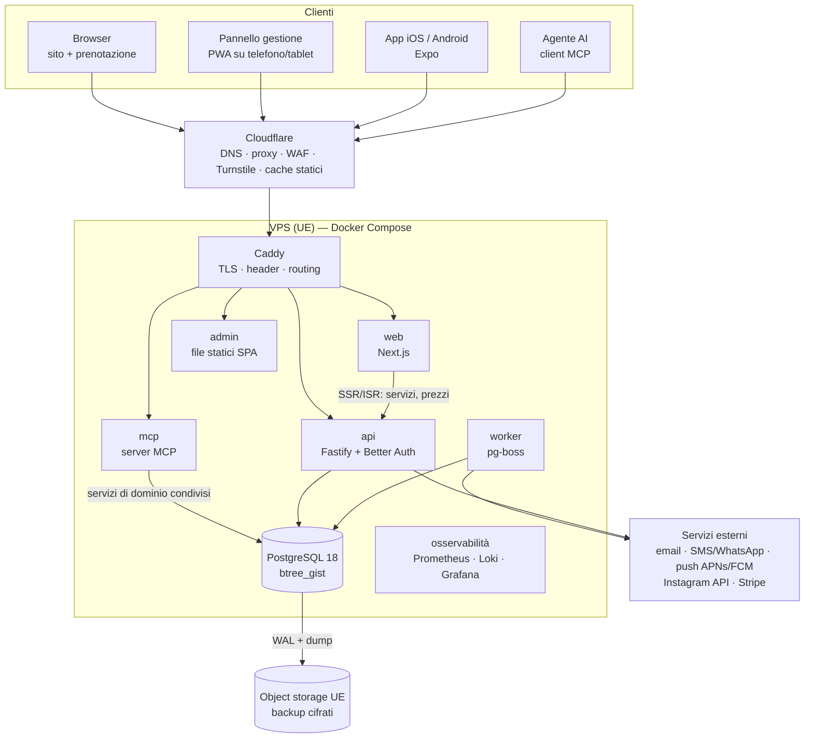
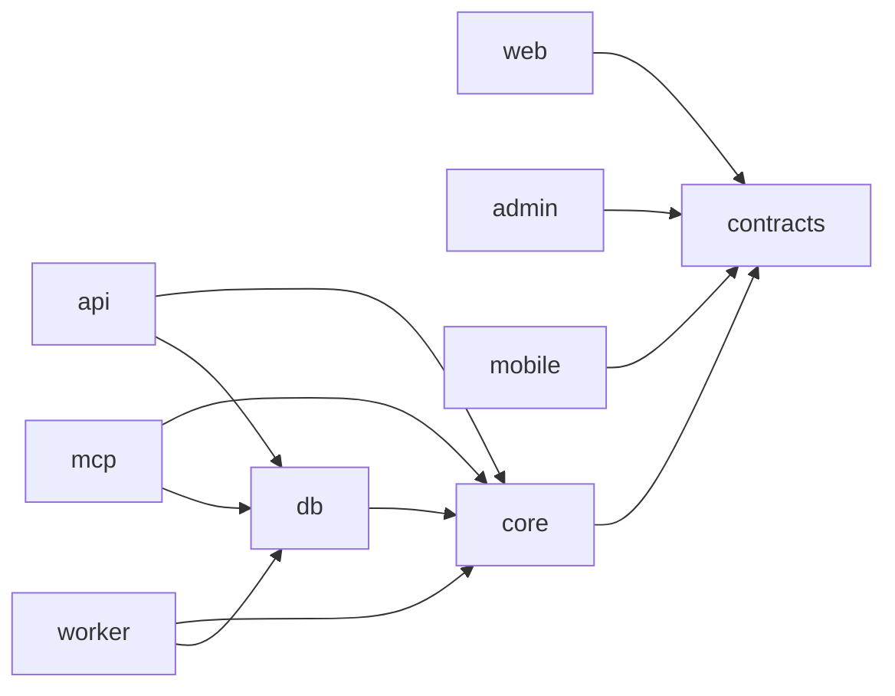
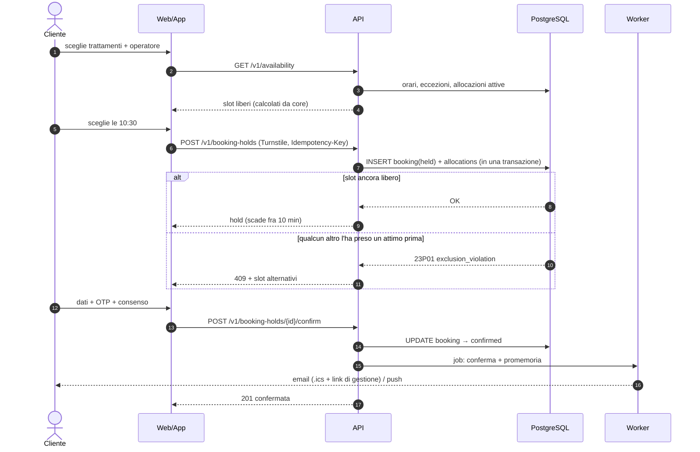

# 04 — Architettura

Stato: `in revisione` · Decisioni collegate: [ADR-0001…0008](adr/README.md)

## 1. Vista d'insieme



**Principio guida:** il dominio vive in **un solo posto** (`packages/core`) e la mutua esclusione è garantita da
**PostgreSQL**. Web, pannello, app e MCP sono *adattatori*: nessuno di questi può aggirare le regole.

## 2. Stack

| Livello | Scelta | Motivo | Alternative scartate |
|---------|--------|--------|----------------------|
| Linguaggio | **TypeScript** (strict) ovunque | Tipi e validazioni condivisi su 6 app | PHP/Laravel e Python/Django: due linguaggi tra web e mobile |
| Runtime | **Node.js 24 LTS** | LTS fino al 2028 | Bun/Deno: ecosistema meno maturo per Expo e Better Auth |
| Monorepo | **pnpm workspaces + Turborepo** | Cache delle build, protezioni supply chain di pnpm (`minimumReleaseAge`, build script in allowlist) | Nx: più pesante |
| Sito | **Next.js** (App Router) + React 19 + Tailwind CSS v4 + `next-intl` | SSR/ISR per SEO e prezzi aggiornati, `next/image`, metadata | Astro: ottimo per la vetrina, ma la prenotazione è un'app React |
| Animazioni | **GSAP** (ScrollTrigger, SplitText, Flip, Draggable) + `@gsap/react` + **Lenis** | GSAP è gratuito con tutti i plugin; skill ufficiali | Motion/Framer: meno adatto allo storytelling legato allo scroll |
| 3D | **three.js** + **React Three Fiber** + drei | Integrazione React, `frameloop="demand"`, lazy loading | Spline: comodo ma pesante e vincolato a un fornitore |
| Pannello | **Vite + React 19 + TanStack Router/Query + shadcn/ui** + **react-big-calendar** (MIT, viste per risorsa + drag & drop) | SPA leggera dietro login, nessun peso 3D, CSP rigida | FullCalendar: le viste per risorsa sono a pagamento (Premium) |
| API | **Fastify 5** + `fastify-type-provider-zod` + OpenAPI 3.1 | Veloce, plugin di sicurezza maturi (helmet, rate-limit, cors), schema = contratto | NestJS: troppo cerimoniale. tRPC: serve un contratto aperto per app e MCP |
| Auth | **Better Auth** (self-hosted) + plugin 2FA/passkey, Expo e OAuth provider (per MCP) | I dati restano nel nostro DB, supporta Expo e passkey | Auth0/Clerk: costi e dati extra-UE. Keycloak: pesante per un salone |
| ORM / SQL | **Drizzle ORM** + migrazioni SQL versionate | SQL-first, query parametrizzate di default, migrazioni SQL scritte a mano per `EXCLUDE` | Prisma: non supporta nativamente i vincoli di esclusione |
| Database | **PostgreSQL 18** (`btree_gist`, `citext`, `uuidv7()`) | Vincoli di esclusione su intervalli, transazioni, `LISTEN/NOTIFY` | MySQL: niente `EXCLUDE` |
| Job | **pg-boss** (coda su Postgres) | Nessun Redis da gestire, job transazionali | BullMQ: richiede Redis |
| Tempo | **Temporal** (`temporal-polyfill`, nativo quando disponibile) | Fusi orari e ora legale corretti per costruzione | Date + date-fns: è facile sbagliare con l'ora legale |
| Telefoni | `libphonenumber-js` | E.164, validazione IT/MT | — |
| Email | **React Email** + provider via API (vedi [20](20-costi.md)) | Template tipizzati e testabili | Server SMTP proprio su VPS: consegna pessima |
| App | **Expo** (React Native, CNG) + Expo Router + EAS | Un codice, due store, skill ufficiali | Flutter: un linguaggio in più. Nativo puro: due codebase |
| MCP | **`@modelcontextprotocol/sdk`** (TypeScript) | SDK ufficiale | — |
| Infrastruttura | Docker Compose + **Caddy** + Cloudflare + Ansible | Semplice, riproducibile, HTTPS automatico | Kubernetes: sproporzionato |

> ⚠️ **Versioni:** al momento dello scaffolding si usa l'ultima stabile di ogni pacchetto, **fissata** nel lockfile.
> Le skill `source-driven-development` ed `expo-upgrade` servono a verificare le API sulla documentazione ufficiale della versione installata.

## 3. Struttura del monorepo (prevista)

```text
apps/
  web/            Next.js — sito vetrina + flusso di prenotazione (IT/EN)
  admin/          Vite SPA — pannello di gestione (PWA)
  api/            Fastify — REST /v1, auth, webhook, SSE realtime
  worker/         pg-boss — promemoria, scadenza hold, sync Instagram, anonimizzazione, invio notifiche
  mcp/            Server MCP (Streamable HTTP) — tool per agenti
  mobile/         Expo — app iOS/Android
packages/
  core/           DOMINIO. Motore slot (funzioni pure, nessun I/O), regole, casi d'uso, porte (interfacce)
  db/             Schema Drizzle, migrazioni SQL, seed, definizione dei ruoli Postgres
  contracts/      Schemi zod condivisi, tipi, OpenAPI generata, client API tipizzato (web/admin/mobile)
  i18n/           Messaggi IT/EN, formattatori di data, ora, valuta e telefono
  notifications/  Template email/SMS/push (React Email) + adattatori dei provider
  ui/             Design token e componenti condivisi web/admin
  config/         tsconfig, eslint (con regole di sicurezza custom), prettier
  testing/        Factory, fixture, helper Testcontainers, generatori fast-check
infra/
  ansible/        Provisioning e hardening della VPS (idempotente)
  compose/        compose.prod.yml, compose.staging.yml, compose.dev.yml
  caddy/          Caddyfile (header di sicurezza, routing, mTLS con l'origine Cloudflare)
  postgres/       postgresql.conf, pg_hba.conf, ruoli e permessi
  backup/         Configurazione pgBackRest/WAL-G e script di restore test
  monitoring/     Prometheus, regole di alert, dashboard Grafana, Loki
docs/             Questa documentazione
brand/            Asset forniti dal cliente (logo, palette, font, foto)
```

### Regole di dipendenza (verificate in CI con `dependency-cruiser`)



- `packages/core` **non importa** framework, HTTP o driver DB. Il motore slot è una funzione pura
  `computeAvailability(input) → Slot[]`: si testa con test di proprietà senza database.
- `apps/mcp` **non** chiama l'API via HTTP con il token dell'utente (*token passthrough*, vietato dalla spec MCP).
  Usa gli stessi casi d'uso di `core` con la **stessa** policy di autorizzazione (vedi [11](11-mcp-agenti.md)).
- Le app client (web, admin, mobile) parlano **solo** con l'API, attraverso il client tipizzato di `contracts`.

## 4. Domini e instradamento

| Host | Servizio | Note |
|------|----------|------|
| `www.<dominio>` | web | Il dominio nudo fa redirect 301 a `www` |
| `api.<dominio>` | api | `/v1/*`, `/v1/auth/*` (Better Auth), webhook |
| `gestione.<dominio>` | admin | `noindex`, CSP più rigida, nessuno script di terze parti |
| `mcp.<dominio>` | mcp | `/mcp` (Streamable HTTP), metadata `/.well-known/oauth-protected-resource` |
| `status.<dominio>` | pagina di stato | Ospitata **fuori** dalla VPS (servizio esterno) |
| `staging-*.<dominio>` | staging | Protetto (accesso Cloudflare / basic auth), `noindex` |

❓ DOMANDA: dominio. Proposta: un `.com` neutro, adatto anche a Malta (es. `arthurstyle.com` o `arthurstylehair.com`),
più il `.it` in redirect. Disponibilità da verificare.

## 5. Flussi principali

### 5.1 Prenotazione (web o app)



### 5.2 Realtime nel pannello

L'API scrive nel DB → un trigger fa `NOTIFY booking_changed` → l'API (in `LISTEN`) inoltra l'evento sullo stream
**SSE** `/v1/admin/events` → il calendario si aggiorna. Heartbeat ogni 25 s, perché Cloudflare chiude le connessioni
inattive dopo circa 100 s. Riconnessione con `Last-Event-ID`.

### 5.3 Notifiche

Ogni invio è un job pg-boss **idempotente** (chiave `booking_id + tipo + canale`), con retry a backoff esponenziale e
dead-letter queue. L'esito finisce in `notification_log`. I promemoria vengono **ricalcolati** quando la prenotazione si sposta.

Regole di invio:

- un promemoria che cadrebbe nel passato o a meno di 30' dall'invio della conferma **non** si invia (prenotazione last minute);
- **ore di silenzio** 21:00–08:00 (ora della sede) per SMS, WhatsApp e push: il promemoria si anticipa alla sera
  prima, entro le 21:00. Le email non hanno vincoli;
- WhatsApp richiede l'**opt-in** del cliente (policy Meta) e template approvati; senza opt-in si usa l'email.

## 6. Aspetti trasversali

| Tema | Regola |
|------|--------|
| **Tempo** | DB in `timestamptz` (UTC). Il fuso sta **sulla sede** (`Europe/Rome`, `Europe/Malta`). Il calcolo avviene in ora locale della sede e si converte con Temporal. Mai `new Date()` nel dominio: si usa una porta `Clock` iniettata (testabile) |
| **Denaro** | Interi in **centesimi** + valuta ISO 4217. Mai float. Aliquota IVA in punti base sulla sede |
| **ID** | `uuidv7()`: ordinabile e non enumerabile. Non sostituisce i controlli di autorizzazione |
| **Errori API** | RFC 9457 `application/problem+json` con `type` stabile e messaggi localizzati lato client |
| **Validazione** | zod a **ogni** confine (HTTP, MCP, job, webhook, env). Parse, don't validate |
| **Configurazione** | Variabili d'ambiente validate all'avvio (fail fast). Nessun default per i segreti (vedi `insecure-defaults`) |
| **Log** | pino JSON, `request_id` propagato, **niente PII** (email e telefono mascherati), livelli per ambiente |
| **i18n** | `packages/i18n`. Lingua del cliente salvata e usata anche nelle notifiche |
| **Feature flag** | Tabella `feature_flags` (es. `deposits_enabled`, `mcp_enabled`, `sms_enabled`) per i rilasci graduali |
| **Accessibilità** | Componenti Radix/shadcn, test axe in CI, `prefers-reduced-motion` rispettato ovunque |

## 7. Ambienti

| Ambiente | Dove | Dati | Scopo |
|----------|------|------|-------|
| `dev` | Locale (Docker Compose) | Seed sintetici | Sviluppo |
| `ci` | GitHub Actions + Testcontainers | Effimeri | Test, scansioni |
| `staging` | VPS piccola separata | Sintetici, **mai** dati reali | Collaudo, E2E, ZAP/sqlmap, prova di restore |
| `prod` | VPS principale (UE) | Reali | Produzione |
