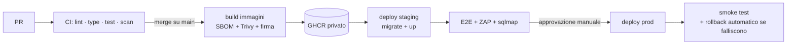

# 13 — Infrastruttura VPS

Stato: `bozza` · Codice: `infra/` · Decisione: [ADR-0007](adr/0007-vps-docker-caddy-cloudflare.md) · Skill: `ci-cd-and-automation`, `observability-and-instrumentation`, `insecure-defaults`

## 1. Server

| Voce | Scelta proposta | Note |
|------|-----------------|------|
| Provider | **Hetzner Cloud** (Germania/Finlandia) oppure **Aruba Cloud** (Italia) | Data center **in UE** (GDPR). ❓ DOMANDA: hai già un provider? |
| Produzione | 4 vCPU · 8 GB RAM · 80+ GB SSD (x86) | Ampio margine: Postgres + Next.js + osservabilità |
| Staging | 2 vCPU · 4 GB RAM, **VPS separata** | Isola le scansioni di sicurezza e i test di restore dalla produzione |
| Sistema operativo | **Ubuntu Server 24.04 LTS** | Supporto fino al 2029 (+ ESM) |
| Architettura | x86_64 | ARM costa meno, ma servono immagini multi-arch: si valuta dopo |
| Firewall del provider | Sì (Hetzner Cloud Firewall) | Prima linea, prima di nftables |
| Snapshot | Settimanale (dal provider) | **Non** sostituisce i backup del DB |

## 2. Provisioning come codice (NFR-13)

Tutto con **Ansible** (`infra/ansible/`), idempotente: dalla VPS vuota a produzione in **< 2 h**, provato davvero su staging.

Ruoli: `base` (utenti, pacchetti, ora, swap) → `hardening` → `docker` → `tailscale` → `crowdsec` → `app` (compose, segreti) → `backup` → `monitoring`.

## 3. Hardening 🔒

| Area | Misura |
|------|--------|
| SSH | Solo chiavi (ed25519), `PasswordAuthentication no`, `PermitRootLogin no`, `AllowUsers deploy`, raggiungibile **solo via Tailscale** (porta 22 chiusa su Internet) |
| Firewall | nftables/ufw *default deny* in ingresso; aperte solo 80/443 **dai range IP di Cloudflare** (lista aggiornata da un job) |
| Origin | **Authenticated Origin Pulls** (mTLS Cloudflare → Caddy): chi conosce l'IP della VPS non bypassa il WAF. In alternativa **Cloudflare Tunnel** (zero porte in ingresso) |
| Aggiornamenti | `unattended-upgrades` per la sicurezza + `needrestart`; riavvio programmato di notte se il kernel lo richiede |
| Intrusioni | **CrowdSec** (log di Caddy e SSH) con bouncer; `auditd` sui file sensibili |
| Utenti | `deploy` senza password sudo limitata ai comandi di deploy; nessun account condiviso |
| Docker | Daemon con `userns-remap` o rootless, `live-restore`, log driver con rotazione, socket **mai** montato nei container |
| Container | Utente non-root, `read_only: true`, `tmpfs` per `/tmp`, `cap_drop: [ALL]`, `security_opt: [no-new-privileges:true]`, limiti di CPU/RAM, healthcheck, immagini base minime (distroless o alpine), digest fissati |
| Rete Docker | `edge` (Caddy ↔ app) e `internal` (app ↔ Postgres, `internal: true`). **Postgres senza porte pubblicate** |
| Postgres | `scram-sha-256`, `listen_addresses` solo sulla rete interna, ruoli a minimo privilegio ([05 §5](05-modello-dati.md)), `log_connections`, `log_min_duration_statement=500ms`, `timezone='UTC'`, `deadlock_timeout` e `lock_timeout` documentati ([06 §4](06-motore-prenotazioni.md)) |
| Proxy fidati | Caddy: `trusted_proxies` = range Cloudflare. Fastify: `trustProxy` = solo Caddy. IP del client da `CF-Connecting-IP` ([12 §5-bis](12-sicurezza.md)) |
| Tempo | `chrony`; fuso del server **UTC** (il fuso della sede sta nell'applicazione) |

## 4. Composizione dei servizi (produzione)

```text
caddy        :443  → TLS (cert Cloudflare Origin o ACME), header di sicurezza, routing per host, compressione
web          Next.js standalone (non-root)
admin        file statici serviti da Caddy (build Vite)
api          Fastify (+ Better Auth)
mcp          stessa immagine di api, entrypoint mcp
worker       stessa immagine di api, entrypoint worker (pg-boss)
migrate      job one-shot a ogni deploy (ruolo app_owner), poi termina
postgres     PostgreSQL 18 + btree_gist (volume dedicato)
backup       pgBackRest/WAL-G (archiviazione WAL continua + backup completi)
umami        analytics senza cookie (DB separato o schema dedicato)
monitoring   node_exporter, cAdvisor, postgres_exporter, Prometheus, Loki + Promtail/Alloy, Grafana (accesso solo via Tailscale)
```

## 5. Deploy



- Deploy **pull-based via SSH su Tailscale** (GitHub Actions → `tailscale up` effimero → `docker compose pull && docker compose run --rm migrate && docker compose up -d`).
- **Migrazioni expand/contract:** ogni migrazione è compatibile con la versione precedente del codice (prima si aggiunge,
  si migra e poi si rimuove in un rilascio successivo). Così il rollback dell'applicazione non richiede il rollback del DB.
- **Rollback:** `IMAGE_TAG=<precedente> docker compose up -d`. Tag immutabili (`sha-<commit>`), mai `latest`.
- Finestra di deploy: fuori dall'orario del salone, mai il sabato mattina.
- Downtime: pochi secondi accettati per `api` (riavvio). Se servisse zero-downtime: due repliche di `api` dietro Caddy con health check.

## 6. Backup e ripristino (NFR-05) 🔒

| Cosa | Come | Frequenza | Conservazione |
|------|------|-----------|---------------|
| PostgreSQL | **pgBackRest** (o WAL-G): archiviazione WAL continua + backup completo settimanale e differenziale giornaliero | continuo (RPO ≤ 15 min) | 30 giorni + 12 mensili |
| Dump logico | `pg_dump -Fc` cifrato | giornaliero | 14 giorni |
| Media (foto galleria, cache Instagram) | `restic` | giornaliero | 30 giorni |
| Configurazione e segreti | Repo `infra/` + copia sops/age | a ogni modifica | storico git |

- Destinazione: **object storage S3-compatibile in UE**, presso un **provider diverso** dalla VPS (se Hetzner salta, i backup sopravvivono). Cifratura lato client (repo cifrato pgBackRest/restic) con chiave custodita **fuori** dal server.
- Bucket con *object lock* / versioning: un attaccante con accesso al server non può cancellare i backup.
- **Restore test automatico mensile** su staging: ripristino in un punto nel tempo → controlli di integrità (conteggi, vincoli) → report e alert se fallisce. Tempo cronometrato e confrontato con l'RTO.

## 7. Osservabilità

| Tipo | Strumento | Cosa |
|------|-----------|------|
| Uptime esterno | Uptime Kuma su un'**altra** macchina, oppure un servizio esterno (Better Stack/UptimeRobot) | `www`, `api/health/ready`, `mcp`, scadenza dei certificati, ogni 1 min |
| Metriche | Prometheus + Grafana | RED per endpoint, latenza del DB, connessioni, coda pg-boss (lag, falliti), disco, RAM |
| Log | Loki (pino JSON) | Correlazione con `request_id`, conservazione 30 giorni |
| Errori | Sentry (regione UE) o GlitchTip self-hosted | API, web, admin, mobile; PII rimosse con `beforeSend` |
| Metriche di business | Grafana | Prenotazioni/ora, 409 vs 201, hold scaduti, notifiche fallite |

**Alert** (Telegram o email a te + Arturo solo per quelli di business): sito giù, 5xx > 1 %, backup fallito,
restore test fallito, disco > 80 %, certificato in scadenza < 14 giorni, coda notifiche ferma, promemoria non inviati,
rinnovo del token Instagram fallito, costo SMS anomalo, picco di 409/429.

## 8. Email e DNS

- Dominio su **Cloudflare** (DNS + proxy). Registrar con MFA e *registrar lock*.
- Email transazionali da un sottodominio dedicato (es. `notifiche.<dominio>`) con **SPF, DKIM e DMARC** (`p=quarantine`, poi `reject`), più **MTA-STS** e TLS-RPT.
- Le email "umane" del salone (es. `info@`) vanno su un servizio di posta separato (Google Workspace / Microsoft 365 / Zoho) ❓.

## 9. Runbook (da scrivere in `docs/runbooks/` durante la Fase 4)

| Runbook | Quando |
|---------|--------|
| `restore-database.md` | Perdita o corruzione dei dati: point-in-time recovery |
| `rebuild-server.md` | VPS persa: nuova VPS + Ansible + restore |
| `rotate-secrets.md` | Uscita di un collaboratore, sospetta compromissione, scadenza annuale |
| `revoke-mcp.md` | Comportamento anomalo di un agente: kill switch + revoca |
| `incident-response.md` | Qualsiasi incidente di sicurezza (con i passi per la notifica GDPR) |
| `double-booking-report.md` | Arturo segnala una doppia prenotazione: query di verifica, audit, cause (inclusa la sovrapposizione forzata) |
| `email-deliverability.md` | Le email finiscono in spam |
| `lost-owner-device.md` | Arturo perde il telefono: revoca sessioni, accesso break-glass, nuova passkey |
| `expo-sdk-upgrade.md` | Upgrade annuale dell'app |
