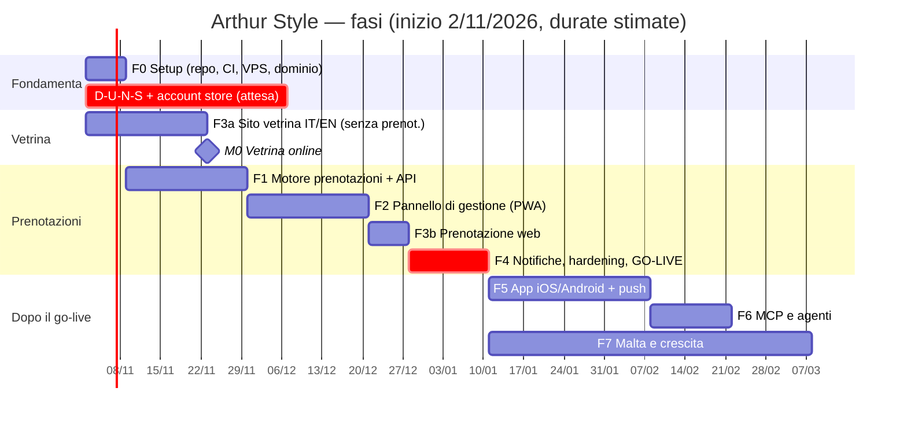

# 16 — Roadmap

Stato: `in revisione` (riordinata il 31/10/2026: trasferimento a Malta fra ~2 mesi, budget 1.500 € + 40 €/mese) ·
Le durate sono **stime** per una persona assistita da agenti; vanno ricalibrate dopo F1. I task diventano issue GitHub con `to-tickets`.

## Panoramica

**Cosa cambia rispetto alla prima versione:** Arturo si trasferisce fra circa 2 mesi e non si sa se Firenze resterà
aperta. Quindi:

1. la **vetrina** (F3a) esce **per prima**, senza aspettare il motore: brand, servizi (mock), lavori, recensioni, WhatsApp,
   "Malta — coming soon" con lista d'attesa. Serve a portare pubblico a Malta **adesso**;
2. il sistema di prenotazione esce già **multi-sede** (ADR-0008/0009): al go-live si attiva la sede che in quel momento è
   operativa (Firenze, Malta o entrambe);
3. i promemoria sono **push** (Q19), quindi l'app (F5) diventa importante e segue subito il go-live web.

> Il go-live delle prenotazioni (fine F4) cade a metà gennaio: dopo le feste e vicino al trasferimento. Va deciso con
> Arturo **quale sede attivare** in quel momento (Q27, Q28).

### Avanzamento (aggiornato il 31/10/2026)

| Task | Stato | Dove |
|------|-------|------|
| F0.5 Brand | ✅ | `brand/` |
| F0.6 Scaffolding monorepo | ✅ pnpm + Turborepo + TS strict + ESLint di sicurezza + Prettier | radice |
| F0.7 CI | ✅ lint, typecheck, test, integrazione su PostgreSQL 18, gitleaks, CodeQL, Renovate (attivarlo su GitHub) | `.github/workflows/` |
| F1.1 Schema + migrazioni | ✅ migrazioni 0000–0003 (schema, macchina a stati, scadenza hold, permessi) | `packages/db/migrations` |
| F1.2 IntervalSet + template | ✅ copertura 100 %, test di proprietà | `packages/core` |
| F1.3 `computeAvailability` | ✅ 41 test (casi E2–E17, ora legale, proprietà), mutanti uccisi | `packages/core` |
| F1.4 Hold → conferma, disdetta, spostamento | ✅ hold (200 richieste concorrenti → 1 successo, 0 deadlock), conferma (sessione, scadenza, email verificata, limite prenotazioni, cliente sovrapposto, token hashato), disdetta (4 giorni per il cliente, riprotezione degli incastri forzati), spostamento atomico. 16 test di integrazione | `packages/db/src/{holds,bookings}.ts` |
| F1.5 Auth | ⏳ | — |
| **F3a Vetrina** | ✅ 18 pagine IT/EN statiche, brand, ciocche animate (GSAP a riposo), listino mock, lavori, contatti, Malta (form solo UI), legali segnaposto. Lighthouse mobile 100/100/100/100, 48 smoke test | `apps/web`, [research](research/2026-10-31-vetrina-lighthouse.md) |
| F3.5 Animazioni GSAP | 🟡 Fatte: titoli per righe (SplitText + ScrollTrigger, nome accessibile intero), foto in ingresso, filtro del listino con Flip, pulsanti magnetici, cambio pagina con "taglio" (React `ViewTransition`). Tutto a riposo e disattivato con `prefers-reduced-motion`; Lighthouse mobile home 99, servizi 100; 54 test E2E. **In attesa di contenuti:** slider prima/dopo con Draggable (Q48), timeline "20 anni" (Q49). **Rinviato:** Lenis (scroll morbido), da valutare con un test su Android per accessibilità e INP | `apps/web/src/components/{MotionLayer,ServiceFilter}.tsx` |
| F1.6 API | 🟡 Base pronta: Fastify 5 + zod, errori RFC 9457, helmet, CORS, rate limit per IP (header `RateLimit-*`), policy di autorizzazione obbligatoria su ogni rotta (l'avvio fallisce senza), OpenAPI 3.1 generata e verificata da un test. Endpoint pubblici: `GET /v1/locations`, `/v1/locations/{slug}`, `/v1/locations/{slug}/services`, `/v1/availability`, health. 20 test HTTP su PostgreSQL. **Mancano:** hold, OTP, conferma, link di gestione, endpoint cliente e admin | `apps/api`, `packages/contracts` |
| F1.8 Seed | 🟡 Seed dal blocco YAML di docs/21 (dati mock), validato con zod; da rifare con il listino reale (Q09) | `packages/db/src/seed.ts` |

**Milestone:**

| Milestone | Contenuto | Uscita stimata |
|-----------|-----------|----------------|
| **M0 — "Vetrina"** | F3a: sito pubblico IT/EN con brand, servizi, lavori, recensioni, contatti, WhatsApp, Malta coming soon | ~fine novembre |
| **M1 — "Agenda vera"** | F1 + F2: Arturo usa il pannello (PC e telefono) per l'agenda | ~fine dicembre |
| **M2 — "Prenotazioni online"** | F3b + F4: prenotazione dal sito, OTP email, notifiche, backup, sicurezza verificata | **~metà gennaio** |
| **M3 — "In tasca"** | F5: app sugli store con promemoria push | ~febbraio |
| **M4 — "Agente"** | F6: gestione tramite agente (dati pseudonimizzati) | ~febbraio–marzo |
| **M5 — "Malta"** | F7: sede di Malta attiva (indirizzo, orari, Google Business Malta), eventuale chiusura di Firenze | Quando l'indirizzo è noto |

---

## F0 — Fondamenta (≈ 1 settimana)

| # | Task | Criterio di accettazione |
|---|------|--------------------------|
| F0.1 | Intervista con `grill-with-docs` sul brief | [17](17-domande-aperte.md): tutte le P0 chiuse; glossario e ADR aggiornati |
| F0.2 | Questionario per Arturo (`to-questionnaire`) | Listino completo (servizi, prezzi, fasi, tempi di posa), orari, operatori, postazioni, policy |
| F0.3 | **Avvio D-U-N-S + account Apple/Google organization** (`wizard`) | Richieste inviate e numero di pratica registrato |
| F0.4 | Dominio, Cloudflare, email aziendale, account intestati al cliente con MFA | Inventario degli account in `docs/accounts.md` (senza segreti) |
| F0.5 | ~~Brand in `brand/`~~ ✅ **fatto** il 31/10/2026: logo vettoriale, palette, token, font OFL, 2 foto provvisorie | — |
| F0.10 | Accesso al **Google Business Profile** + decisione su **Treatwell** (Q43) + indirizzo corretto (Q44) | Indirizzo identico su Google, sito e note legali |
| F0.6 | Scaffolding del monorepo (pnpm + Turborepo, config condivise, regole ESLint di sicurezza) | `pnpm build`, `pnpm test`, `pnpm lint` verdi su repo vuota |
| F0.7 | CI di base + gitleaks + CodeQL + Renovate + branch protection | PR di prova bloccata da un segreto finto |
| F0.8 | Provisioning della **tua VPS** (prod + staging isolato) con Ansible | `nmap` da fuori: solo 443/80. SSH solo via Tailscale. Dettagli VPS: Q45 |
| F0.9 | Contratti: sviluppo, manutenzione, DPA | Firmati |

## F1 — Motore prenotazioni + API (≈ 3 settimane)

| # | Task | Criterio di accettazione |
|---|------|--------------------------|
| F1.1 | Schema DB + migrazioni + ruoli ([05](05-modello-dati.md)) | Migrazione su Postgres 18 pulito; i vincoli `EXCLUDE` rifiutano le sovrapposizioni nei test |
| F1.2 | `IntervalSet` + template dei servizi (TDD) | Copertura ≥ 95 %, test di proprietà verdi |
| F1.3 | `computeAvailability` (funzione pura) | Tutti i casi E1–E20 di [06](06-motore-prenotazioni.md) coperti da test |
| F1.4 | Hold → conferma, spostamento, annullamento (transazioni) | Test di concorrenza: 200 richieste → 1 × 201, 199 × 409 |
| F1.5 | Better Auth: staff con MFA, clienti con OTP | Login pannello con passkey e TOTP; OTP con limiti e anti-enumerazione |
| F1.6 | API pubblica e admin (contratto OpenAPI + client tipizzato) | Diff OpenAPI in CI; matrice di autorizzazione verde |
| F1.7 | Worker: scadenza hold, outbox notifiche (inizialmente solo email) | Hold scaduti liberati entro 60 s |
| F1.8 | Seed con il listino reale di Arturo | Disponibilità calcolata uguale a quella che Arturo si aspetta (golden test) |

## F2 — Pannello di gestione MVP (≈ 3 settimane)

| # | Task | Criterio di accettazione |
|---|------|--------------------------|
| F2.1 | Shell PWA, login, layout mobile-first | Installabile su iOS/Android; Lighthouse PWA ok |
| F2.2 | Vista **Oggi** + calendario per operatore | Le 5 azioni quotidiane in ≤ 3 tocchi (test con Arturo) |
| F2.3 | Creazione rapida, drag & drop, blocchi con anteprima dei conflitti | 409/412 gestiti con rollback visivo e messaggio chiaro |
| F2.4 | Editor trattamenti con fasi e tempo di posa | Arturo inserisce da solo un servizio con posa |
| F2.5 | Orari, ferie, festività | Festività IT + San Giovanni precaricate |
| F2.6 | Clienti: ricerca, scheda, note, export/anonimizza | Export JSON valido; anonimizzazione irreversibile |
| F2.7 | Realtime SSE | Una prenotazione creata da un altro dispositivo appare in < 2 s |
| F2.8 | Audit log consultabile | Ogni modifica tracciata con l'attore |
| F2.10 | Web Push ad Arturo dalla PWA (ADMIN-23) | Notifica ricevuta su iPhone con la PWA installata |
| F2.11 | Controllo notturno delle invarianti ([06 §8](06-motore-prenotazioni.md)) | Alert di prova su un'anomalia creata a mano in staging |
| **M1** | Arturo usa il pannello per **2 settimane** in parallelo all'agenda attuale | Lista di modifiche raccolta e prioritizzata |

## F3 — Sito: F3a vetrina (≈ 3 settimane, subito) · F3b prenotazione web (≈ 1 settimana, dopo F2)

F3a = righe F3.1–F3.5, F3.7–F3.10 (senza prenotazione: il pulsante "Prenota" porta a WhatsApp/telefono finché F3b non è pronta; i servizi si leggono dal listino
[mock](21-dati-mock.md) in un file statico, poi dall'API). F3b = F3.6.

| # | Task | Criterio di accettazione |
|---|------|--------------------------|
| F3.1 | Direzione creativa (`idea-refine`) + moodboard dai materiali Instagram | Approvata da te e da Arturo |
| F3.2 | **Prototipo hero 3D** (`prototype`) su un Android di fascia media | ≥ 50 fps, LCP invariato, fallback ok |
| F3.3 | Design system (token condivisi con admin e app) | Token in `packages/ui`, contrasto AA verificato |
| F3.4 | Pagine (home, Arturo, servizi, lavori, contatti, legali) IT/EN | Contenuti reali, niente lorem ipsum |
| F3.5 | Animazioni GSAP (SplitText, ScrollTrigger, Flip, Draggable) | `prefers-reduced-motion` rispettato; nessuna regressione CLS |
| F3.6 | Flusso `/prenota` collegato all'API | E2E verde: prenotazione, 409 con alternative, OTP |
| F3.7 | SEO: JSON-LD, sitemap, hreflang, OG | Rich Results Test valido; Search Console configurata |
| F3.8 | Integrazione Instagram (app Meta, token, sync) | Feed aggiornato; fallback dalla cache testato |
| F3.9 | Umami + eventi di conversione | Funnel visibile |
| F3.10 | Pagina **Malta — coming soon** + lista d'attesa (double opt-in) + galleria e testi in `content/` (EXIF rimossi in build) | Iscrizione di prova con conferma via email |

## F4 — Notifiche, hardening, GO-LIVE web (≈ 2 settimane)

| # | Task | Criterio di accettazione |
|---|------|--------------------------|
| F4.1 | Email transazionali IT/EN (React Email) + `.ics` + link di gestione | SPF/DKIM/DMARC ok; test di deliverability (Gmail, Outlook, iCloud) |
| F4.2 | Promemoria via **email** per chi non ha l'app (le push arrivano con F5); notifica ad Arturo (Web Push PWA + email) | Ripianificazione corretta dopo uno spostamento |
| F4.4 | Backup pgBackRest + **restore test** | Restore cronometrato ≤ RTO |
| F4.5 | Osservabilità + alert | Alert di prova ricevuti |
| F4.6 | Audit di sicurezza: `audit-context-building`, ZAP, **sqlmap**, checklist [12 §9](12-sicurezza.md) | Zero High/Critical aperti |
| F4.7 | Pagine legali, informativa, registro trattamenti | Revisionati dal consulente |
| F4.8 | Runbook ([13 §9](13-infrastruttura-vps.md)) | Scritti e provati almeno restore e rebuild |
| F4.9 | Google Business Profile, Apple Business Connect, Bing Places | Link "Prenota" attivi con UTM |
| **M2** | **Go-live** + aggiornamento della bio Instagram + annuncio | Prima prenotazione online reale 🎉 |

## F5 — App iOS/Android (≈ 4 settimane)

| # | Task | Criterio di accettazione |
|---|------|--------------------------|
| F5.1 | Scaffolding Expo (skill `expo-project-structure`) + navigazione | Build di sviluppo su iOS e Android |
| F5.2 | Prenotazione, appuntamenti, salone, profilo | Parità funzionale con il web |
| F5.3 | Push, calendario, deep link | Universal/App Links verificati |
| F5.4 | Elimina account, export, consensi | Conforme a Apple 5.1.1(v) e Google Play |
| F5.5 | Modalità staff | Arturo riceve una push per ogni prenotazione |
| F5.6 | E2E Maestro | Flussi critici verdi |
| F5.7 | Materiale store, privacy label, Data safety, account demo | Checklist [10 §4](10-app-mobile.md) completa |
| **M3** | TestFlight + internal testing → produzione con rilascio graduale | App approvate |

## F6 — MCP e agenti (≈ 2 settimane)

| # | Task | Criterio di accettazione |
|---|------|--------------------------|
| F6.1 | OAuth provider (Better Auth) + metadata RFC 9728 | Flusso completo con MCP Inspector |
| F6.2 | Tool di lettura | Test per ogni scope |
| F6.3 | Tool di scrittura in due fasi | Replay e scadenza di `confirmation_id` testati |
| F6.4 | Audit, limiti, kill switch nel pannello | Kill switch → tutti i token revocati in < 5 s |
| F6.5 | Prompt `daily_briefing`, `fill_the_gaps` | Usati da Arturo per una settimana |
| **M4** | Rilascio | Review di sicurezza (`sharp-edges`, `differential-review`) senza finding aperti |

## F7 — Crescita e Malta (continuo)

- Lista d'attesa automatica (BOOK-13) · richiesta recensioni (BOOK-14) · caparra Stripe (BOOK-15) · ricorrenze (BOOK-16)
  - ⚠️ Caparra: il TTL dell'hold (10') è più breve di una sessione di pagamento. Si usa il pagamento *in pagina*
    (Payment Element) con un hold esteso solo dopo l'avvio del pagamento (es. 20'), il webhook conferma e il rimborso
    automatico parte se la conferma arriva dopo la scadenza.
- Gift card (SITE-13) · journal SEO (SITE-12) · Wallet pass (APP-10) · MCP pubblico (MCP-07)
- **Playbook Malta** (M5, priorità alta dato il trasferimento): nuova sede (`locations`, IVA, fuso, telefono) → contenuti EN → profilo Google Malta → ri-consenso
  marketing dei clienti → pagina "Ci siamo trasferiti" con 301 se Firenze chiude → nuove informative (nuovo titolare).
