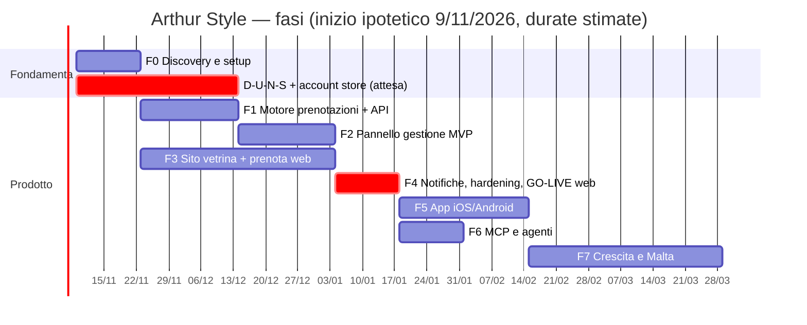

# 16 — Roadmap

Stato: `bozza` · Le durate sono **stime** per una persona assistita da agenti. Vanno ricalibrate dopo la Fase 1 con
la velocità reale. I task diventano issue GitHub con la skill `to-tickets`.

## Panoramica

> Il periodo natalizio è pieno di lavoro per un salone: test con Arturo e go-live vanno concordati in modo da **non**
> cadere a dicembre. Meglio un go-live a gennaio con un'agenda tranquilla.

La F3 (design e sito) procede **in parallelo** con F1-F2: il design non dipende dal backend, la pagina servizi e la
prenotazione si collegano all'API quando è pronta.

**Milestone:**

| Milestone | Contenuto | Uscita |
|-----------|-----------|--------|
| **M1 — "Agenda vera"** | F1 + F2: Arturo usa il pannello al posto dell'agenda attuale, con le prenotazioni inserite a mano | Fine F2 |
| **M2 — "Online"** | F3 + F4: sito pubblico, prenotazione online, notifiche, backup, sicurezza verificata | **Go-live web** |
| **M3 — "In tasca"** | F5: app sugli store | Pubblicazione |
| **M4 — "Agente"** | F6: Arturo gestisce l'agenda anche tramite agente | Rilascio MCP |
| **M5 — "Malta ready"** | F7: seconda sede attivabile, contenuti EN completi, lista d'attesa | Su richiesta |

---

## F0 — Discovery e fondamenta (≈ 2 settimane)

| # | Task | Criterio di accettazione |
|---|------|--------------------------|
| F0.1 | Intervista con `grill-with-docs` sul brief | [17](17-domande-aperte.md): tutte le P0 chiuse; glossario e ADR aggiornati |
| F0.2 | Questionario per Arturo (`to-questionnaire`) | Listino completo (servizi, prezzi, fasi, tempi di posa), orari, operatori, postazioni, policy |
| F0.3 | **Avvio D-U-N-S + account Apple/Google organization** (`wizard`) | Richieste inviate e numero di pratica registrato |
| F0.4 | Dominio, Cloudflare, email aziendale, account intestati al cliente con MFA | Inventario degli account in `docs/accounts.md` (senza segreti) |
| F0.5 | Raccolta del brand in `brand/` (logo SVG, palette, font con licenza web, foto) | File presenti, licenze dei font verificate |
| F0.6 | Scaffolding del monorepo (pnpm + Turborepo, config condivise, regole ESLint di sicurezza) | `pnpm build`, `pnpm test`, `pnpm lint` verdi su repo vuota |
| F0.7 | CI di base + gitleaks + CodeQL + Renovate + branch protection | PR di prova bloccata da un segreto finto |
| F0.8 | Provisioning VPS staging + prod con Ansible | `nmap` da fuori: solo 443/80. SSH solo via Tailscale |
| F0.9 | Contratti: sviluppo, manutenzione, DPA | Firmati |

## F1 — Motore prenotazioni + API (≈ 3 settimane)

| # | Task | Criterio di accettazione |
|---|------|--------------------------|
| F1.1 | Schema DB + migrazioni + ruoli ([05](05-modello-dati.md)) | Migrazione su Postgres 18 pulito; i vincoli `EXCLUDE` rifiutano le sovrapposizioni nei test |
| F1.2 | `IntervalSet` + template dei servizi (TDD) | Copertura ≥ 95 %, test di proprietà verdi |
| F1.3 | `computeAvailability` (funzione pura) | Tutti i casi E1–E20 di [06](06-motore-prenotazioni.md) coperti da test |
| F1.4 | Hold → conferma, spostamento, annullamento (transazioni) | Test di concorrenza: 200 richieste → 1 × 201, 199 × 409 |
| F1.5 | Better Auth: staff con MFA, clienti con OTP | Login pannello con passkey e TOTP; OTP con limiti e anti-enumerazione |
| F1.6 | API pubblica e admin (contratto OpenAPI + client tipizzato) | Diff OpenAPI in CI; matrice di autorizzazione verde |
| F1.7 | Worker: scadenza hold, outbox notifiche (inizialmente solo email) | Hold scaduti liberati entro 60 s |
| F1.8 | Seed con il listino reale di Arturo | Disponibilità calcolata uguale a quella che Arturo si aspetta (golden test) |

## F2 — Pannello di gestione MVP (≈ 3 settimane)

| # | Task | Criterio di accettazione |
|---|------|--------------------------|
| F2.1 | Shell PWA, login, layout mobile-first | Installabile su iOS/Android; Lighthouse PWA ok |
| F2.2 | Vista **Oggi** + calendario per operatore | Le 5 azioni quotidiane in ≤ 3 tocchi (test con Arturo) |
| F2.3 | Creazione rapida, drag & drop, blocchi con anteprima dei conflitti | 409/412 gestiti con rollback visivo e messaggio chiaro |
| F2.4 | Editor trattamenti con fasi e tempo di posa | Arturo inserisce da solo un servizio con posa |
| F2.5 | Orari, ferie, festività | Festività IT + San Giovanni precaricate |
| F2.6 | Clienti: ricerca, scheda, note, export/anonimizza | Export JSON valido; anonimizzazione irreversibile |
| F2.7 | Realtime SSE | Una prenotazione creata da un altro dispositivo appare in < 2 s |
| F2.8 | Audit log consultabile | Ogni modifica tracciata con l'attore |
| F2.9 | Galleria con liberatorie + rimozione EXIF (ADMIN-21) | Una foto con GPS caricata risulta senza metadati |
| F2.10 | Web Push ad Arturo dalla PWA (ADMIN-23) | Notifica ricevuta su iPhone con la PWA installata |
| F2.11 | Controllo notturno delle invarianti ([06 §8](06-motore-prenotazioni.md)) | Alert di prova su un'anomalia creata a mano in staging |
| **M1** | Arturo usa il pannello per **2 settimane** in parallelo all'agenda attuale | Lista di modifiche raccolta e prioritizzata |

## F3 — Sito vetrina + prenotazione web (≈ 6 settimane, in parallelo)

| # | Task | Criterio di accettazione |
|---|------|--------------------------|
| F3.1 | Direzione creativa (`idea-refine`) + moodboard dai materiali Instagram | Approvata da te e da Arturo |
| F3.2 | **Prototipo hero 3D** (`prototype`) su un Android di fascia media | ≥ 50 fps, LCP invariato, fallback ok |
| F3.3 | Design system (token condivisi con admin e app) | Token in `packages/ui`, contrasto AA verificato |
| F3.4 | Pagine (home, Arturo, servizi, lavori, contatti, legali) IT/EN | Contenuti reali, niente lorem ipsum |
| F3.5 | Animazioni GSAP (SplitText, ScrollTrigger, Flip, Draggable) | `prefers-reduced-motion` rispettato; nessuna regressione CLS |
| F3.6 | Flusso `/prenota` collegato all'API | E2E verde: prenotazione, 409 con alternative, OTP |
| F3.7 | SEO: JSON-LD, sitemap, hreflang, OG | Rich Results Test valido; Search Console configurata |
| F3.8 | Integrazione Instagram (app Meta, token, sync) | Feed aggiornato; fallback dalla cache testato |
| F3.9 | Umami + eventi di conversione | Funnel visibile |

## F4 — Notifiche, hardening, GO-LIVE web (≈ 2 settimane)

| # | Task | Criterio di accettazione |
|---|------|--------------------------|
| F4.1 | Email transazionali IT/EN (React Email) + `.ics` + link di gestione | SPF/DKIM/DMARC ok; test di deliverability (Gmail, Outlook, iCloud) |
| F4.2 | Promemoria 24 h / 2 h; notifica ad Arturo | Ripianificazione corretta dopo uno spostamento |
| F4.3 | (Opzionale) SMS/WhatsApp con limiti anti-pumping | Tetto di spesa attivo |
| F4.4 | Backup pgBackRest + **restore test** | Restore cronometrato ≤ RTO |
| F4.5 | Osservabilità + alert | Alert di prova ricevuti |
| F4.6 | Audit di sicurezza: `audit-context-building`, ZAP, **sqlmap**, checklist [12 §9](12-sicurezza.md) | Zero High/Critical aperti |
| F4.7 | Pagine legali, informativa, registro trattamenti | Revisionati dal consulente |
| F4.8 | Runbook ([13 §9](13-infrastruttura-vps.md)) | Scritti e provati almeno restore e rebuild |
| F4.9 | Google Business Profile, Apple Business Connect, Bing Places | Link "Prenota" attivi con UTM |
| **M2** | **Go-live** + aggiornamento della bio Instagram + annuncio | Prima prenotazione online reale 🎉 |

## F5 — App iOS/Android (≈ 4 settimane)

| # | Task | Criterio di accettazione |
|---|------|--------------------------|
| F5.1 | Scaffolding Expo (skill `expo-project-structure`) + navigazione | Build di sviluppo su iOS e Android |
| F5.2 | Prenotazione, appuntamenti, salone, profilo | Parità funzionale con il web |
| F5.3 | Push, calendario, deep link | Universal/App Links verificati |
| F5.4 | Elimina account, export, consensi | Conforme a Apple 5.1.1(v) e Google Play |
| F5.5 | Modalità staff | Arturo riceve una push per ogni prenotazione |
| F5.6 | E2E Maestro | Flussi critici verdi |
| F5.7 | Materiale store, privacy label, Data safety, account demo | Checklist [10 §4](10-app-mobile.md) completa |
| **M3** | TestFlight + internal testing → produzione con rilascio graduale | App approvate |

## F6 — MCP e agenti (≈ 2 settimane)

| # | Task | Criterio di accettazione |
|---|------|--------------------------|
| F6.1 | OAuth provider (Better Auth) + metadata RFC 9728 | Flusso completo con MCP Inspector |
| F6.2 | Tool di lettura | Test per ogni scope |
| F6.3 | Tool di scrittura in due fasi | Replay e scadenza di `confirmation_id` testati |
| F6.4 | Audit, limiti, kill switch nel pannello | Kill switch → tutti i token revocati in < 5 s |
| F6.5 | Prompt `daily_briefing`, `fill_the_gaps` | Usati da Arturo per una settimana |
| **M4** | Rilascio | Review di sicurezza (`sharp-edges`, `differential-review`) senza finding aperti |

## F7 — Crescita e Malta (continuo)

- Lista d'attesa automatica (BOOK-13) · richiesta recensioni (BOOK-14) · caparra Stripe (BOOK-15) · ricorrenze (BOOK-16)
  - ⚠️ Caparra: il TTL dell'hold (10') è più breve di una sessione di pagamento. Si usa il pagamento *in pagina*
    (Payment Element) con un hold esteso solo dopo l'avvio del pagamento (es. 20'), il webhook conferma e il rimborso
    automatico parte se la conferma arriva dopo la scadenza.
- Gift card (SITE-13) · journal SEO (SITE-12) · Wallet pass (APP-10) · MCP pubblico (MCP-07)
- **Playbook Malta:** nuova sede (`locations`, IVA, fuso, telefono) → contenuti EN → profilo Google Malta → ri-consenso
  marketing dei clienti → pagina "Ci siamo trasferiti" con 301 se Firenze chiude → nuove informative (nuovo titolare).
